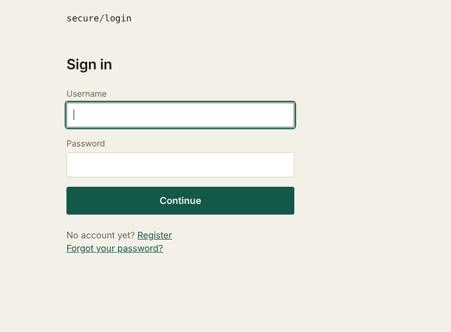
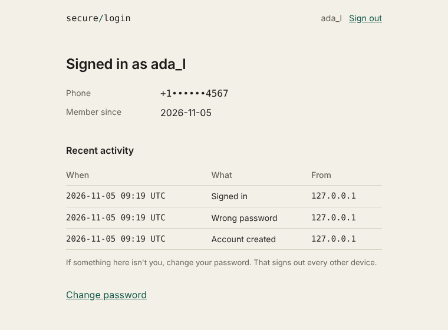

# Secure Login

A small Flask login system where signing in takes two things: your password, then a code texted to your phone. Passwords are stored as bcrypt hashes, codes come from Twilio Verify, and accounts lock after repeated failures.



It started as a prototype by Michele Regina ([cybersecurityProject](https://github.com/Micheleregina2022/cybersecurityProject)): bcrypt hashing plus a Twilio 2FA form. This version keeps that core and fills in what a real login needs.

## What it does

- **Two-step sign-in.** Password first, then an SMS code checked against Twilio Verify. Neither step alone gives you a session.
- **Password rules.** 10+ characters, at most 72 bytes (bcrypt's limit), no common passwords, nothing containing your username. Length over symbol rules on purpose.
- **Lockout.** Five failures in a row, wrong passwords or wrong codes, lock the account for 15 minutes. The sign-in form gives the same answer for an unknown user, a wrong password and a locked account.
- **Rate limits** on sign-in, registration, code entry and code resend.
- **Change password** and **reset by SMS.** Either one signs the account out on every other device.
- **Recent activity** on the account page: sign-ins, failures, lockouts and password changes with the address they came from.
- **Hardening.** CSRF tokens on every POST, a CSP with no inline script or style, `HttpOnly` / `SameSite=Lax` cookies, `no-store` on account pages, 30 minute idle timeout.



## Run it

You need Python 3.9 or newer.

```
python -m venv .venv
source .venv/bin/activate          # Windows: .venv\Scripts\activate
pip install -r requirements.txt
cp .env.example .env               # Windows: copy .env.example .env
```

Put a secret in `.env`:

```
python -c "import secrets; print(secrets.token_hex(32))"
```

Then:

```
python login_crypt/app.py
```

and open http://127.0.0.1:5000. With the default `SMS_BACKEND=console`, codes are printed in the terminal instead of sent, so you can try everything without a Twilio account.

### Real SMS with Twilio

1. In the Twilio console, create a **Verify service** and note its SID (starts with `VA`).
2. In `.env`, set:

   ```
   SMS_BACKEND=twilio
   TWILIO_ACCOUNT_SID=AC...
   TWILIO_AUTH_TOKEN=...
   TWILIO_VERIFY_SERVICE_SID=VA...
   ```

Trial Twilio accounts can only text numbers you've verified in the console. Phone numbers are entered with a country code, like `+15551234567`.

### Settings

| Variable | Default | |
| --- | --- | --- |
| `SECRET_KEY` | none, required | Signs the session cookie. |
| `SMS_BACKEND` | `console` | `console` or `twilio`. |
| `TWILIO_*` | empty | Needed when `SMS_BACKEND=twilio`. |
| `COOKIE_SECURE` | `0` | Set to `1` behind HTTPS. Also renames the cookie to `__Host-session` and sends HSTS. |
| `DATABASE` | `login_crypt/register.db` | SQLite file. |
| `FLASK_DEBUG` | `0` | Never leave on in production. |

## Tests

```
pip install -r requirements-dev.txt
pytest
```

The suite replaces Twilio with a fake, so nothing sends a text. The one thing it can't prove is a live call to Twilio; try that once with your own Verify service.

## How a sign-in works

```
password ok? ──no──► failure counted, one generic message
     │yes
     ▼
text a code ──► /login/verify ──wrong──► failure counted (5 = locked)
                     │right
                     ▼
               session issued, failures cleared, event logged
```

## Layout

```
login_crypt/
  app.py          routes and the app factory
  users.py        password hashing, lockout, accounts
  validators.py   password, username and phone rules
  sms.py          Twilio Verify, plus a console stand-in
  ratelimit.py    sliding-window limiter
  hardening.py    CSRF and response headers
  events.py       activity log
  db.py           SQLite connection, schema, upgrades
  config.py       environment settings
  templates/  static/
tests/
```

## Things to know before deploying

- **Rotate any Twilio token that was ever committed.** Earlier versions of this repo had credentials in `app.py`; they are still in git history.
- **Rate limits live in process memory.** Fine for one worker. With several, each counts separately; use a shared store.
- **Behind a reverse proxy** `request.remote_addr` is the proxy's address, which breaks per-IP limits and the activity log. Wrap the app in Werkzeug's `ProxyFix` and configure it for your proxy.
- **SMS is the weak factor.** SIM-swap attacks exist, and SMS reset means whoever controls the number controls the account. An authenticator app is the next step up.
- **Client addresses are stored** in the activity log (last 200 events per user). That can be personal data where you live.
- **Accounts from the earlier version** keep working: the new columns are added on startup. They need a phone number on file to receive codes.
- Registration reveals whether a username is taken. Avoiding that needs email confirmation, which this project doesn't have.
